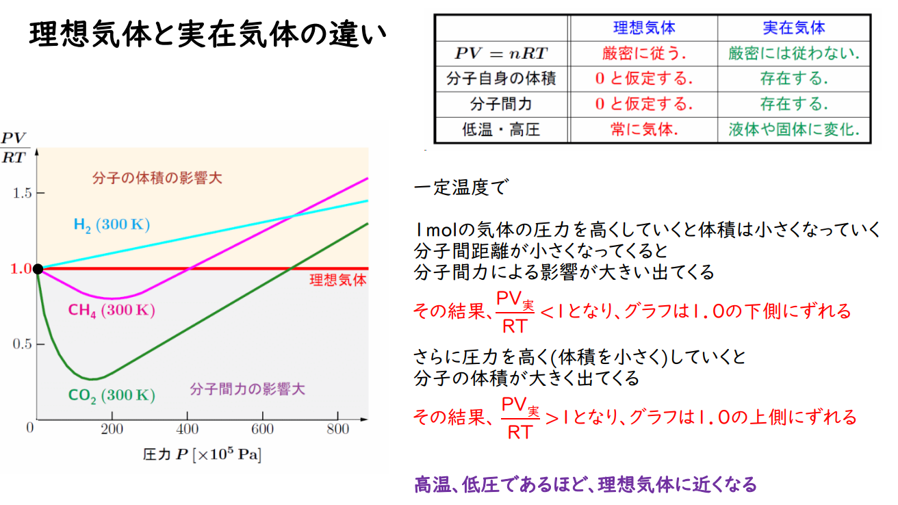
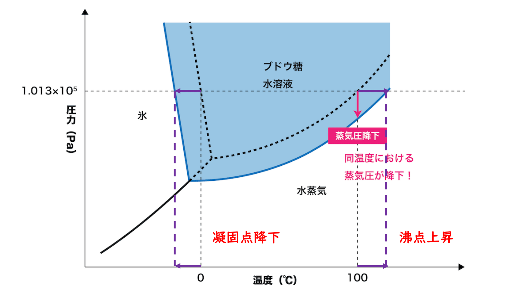

# 間違いノート

## 理論化学

### 1. 反応原理

1. 触媒会改变反应路径。不如说，触媒就是依托改变反应路径来降低活化能的。

2. **【勒夏特列原理】**

   变化向缓和影响的方向移动。

   浓度增加：该物质浓度减少方向；

   浓度减少：该物质浓度增加方向；

   温度加热：吸热反应方向（为了让温度下降）；

   温度冷却：放热反应方向（为了让温度上升）；

   压强增加：气体分子数减少方向；

   压强减少：气体分子数增加方向。

   ---

   需要注意的是加入惰性气体的情况。温度体积一定，由于分压不变，平衡不移动；温度全压一定，分压变小，因此会向气体分子数增加方向移动。

3. 计算平衡系数的时候，首先列三段式。
   $$
   \ce{aA + bB <=> cC + dD}\\
   K=\dfrac{[\ce C]^c[\ce D]^d}{[\ce A]^a[\ce B]^b}
   $$

4. 

### 2. 元素周期律

1. 電子親和力とは、気体状態の原子が電子を1個受け取って、1価の陰イオンになるときに**放出されるエネルギー**のことです。必要なエネルギーではない。1価の陰イオンから電子1個を取り去って原子にするのに必要なエネルギーと等しい。
1. 判断沸点，首先考虑分子间力（氢键），其次是相对分子质量，最后再看具体分子形态。

### 3. 酸と塩基

1. $\ce{H2SO4}$ 两段电离，电离不完全。
1. 计算 pH 值不要忘记，算的是氢离子浓度而不是摩尔数；水的离子积是 $1\times 10^{-14}$。

### 4. 电化学

【重点】

1. 金属活跃性差距越大，电压越大；
2. 反应持续时间越长、反应物越多，电气量越大。

---

ボルタ電池：
$$
\ce{(-) Zn | H2SO4 aq | Cu (+)}
$$
ダニエル電池：
$$
\ce{(-) Zn | ZnSO4 aq | CuSO4 aq | Cu (+)}
$$
鉛蓄電池：
$$
\ce{(-) Pb | H2SO4 aq| PbO2 (+)}
$$
注意，是放电过程。

放电过程中，两极均生成 $\ce{PbSO4}$ 沉淀，质量均增加，且上升质量比为 $2:3$。充电过程中，$\ce{PbSO4}$ 被反应，质量均下降。

----

**電気分解：**

阴极看阳离子：活泼性小于 $\ce{H+}$，则析出金属单体（例如 $\ce{Cu, Ag}$）；否则生成氢气。

阳极先看材质：如果是金属电极，金属自身反应；如果是惰性电极，水溶液有卤素离子时生成卤族气体（例如 $\ce{Cl2, I2}$），否则生成氧气。

### 5. その他

1. 

2. 

   如图，蒸气压降下导致两个结果：沸点上升和凝固点降下。

   沸点上升、凝固点降下遵循：$\Delta T=Km$，其中 $m$ 是质量摩尔浓度。也就是说只和**物质的量**有关。

   需要注意的是，溶于水中，如果解离成离子要按照离子数计算。

3. 

## 無機化学

### 1. ミョウバン（$\ce{KAl(SO4)2.12H2O}$）

1. 正八面体の結晶であり、複塩である。
2. 硫酸カリウムと硫酸アルミニウムの混合溶液を濃縮すると得られる。
3. 水溶液は酸性を示す。$\ce{Al^3+ + 3H2O <=> Al(OH)3 + H+}$

### 2. ハロゲン

1. $\ce{HF}$ は弱酸であり、$\ce{HCl, HBr, HI}$ は強酸である。
2. 酸化力の強さは原子番号の小さいものほど大きい。

### 3. 気体発生

1. $\ce{Cu + 2H2SO4(濃) ->[\Delta] CuSO4 + SO2 ^ + 2H2O}$，加熱が必要。
2. $\ce{2Al + 2NaOH + 6H2O -> 2Na[Al(OH)4] + 3H2 ^}$
3. $\ce{Zn + 2HCl -> ZnCl2 + H2}$
4. $\ce{MnO2 + 4HCl(濃) ->[\Delta] MnCl2 + Cl2 ^ + 2H2O}$

### 4. 金属イオンとその沈殿

1. 氨水无法让 $\ce{Al, Sn, Pb}$ 形成羟基和络离子，因为提供的 $\ce{pH}$ 过低。
2. 金属硫化物，只有 $\ce{MnS,CdS,ZnS}$ 三个特例（淡粉色，黄色，白色），其余全都是黑色。
3. 注意盐水溶液的液性与盐的类别有关。例如，盐的水溶液呈酸性，证明是强酸弱碱盐。
4. **Ag是导电性、导热性最强的金属**。
5. 工业制备 $\ce{Al}$，熔融盐电解 $\ce{Al2O3}$，需要冰晶石 $\ce{Na3AlF6}$。

### 5. リン

1. 白磷（黄リン）会自燃，需要保存在水中。
2. $\ce{P4O10}$ 是吸水剂，具有潮解性。
3. $\ce{P4O10}$ 溶于水加热，可以得到 $\ce{H3PO4}$。
4. 

## 有機化学

### 官能基とその性質

1. $\ce{Na}$ 可以检测所有羟基，包括羧基。

2. $\ce{NaHCO3}$ 检测除了酚类以外的酸性物，原理是弱酸的游离。

3. 酸性强弱：
   $$
   \ce{HCl , H2SO4 , Ph-SO3H > R-COOH > H2CO3 > Ph-OH}
   $$

4. 碘仿反应：含有乙酰基、或者可以被氧化为乙酰基
   $$
   \ce{CH3-CO-R/H | CH3-CH(OH)-R/H}
   $$
   

### 天然高分子

#### 糖类

单糖 $\ce{C6H12O6}$：

1. 葡萄糖 グルコース（ブドウ糖） Glucose
2. 果糖 フルクトース（果糖） Fructose
3. 半乳糖 ガラクトース Galactose

二糖 $\ce{C12H22O11}$：

1. 麦芽糖 マルトース（麦芽糖） Maltose

   $\alpha$-葡萄糖 ＋ $\alpha$-葡萄糖

2. 蔗糖 スクロース（ショ糖） Sucrose，唯一没有还原性的二糖

   $\alpha$-葡萄糖 ＋ $\beta$-果糖

3. 乳糖 ラクトース（乳糖） Lactose

   葡萄糖 ＋ $\beta$-半乳糖

多糖 $\ce{(C6H10O5)_n}$：

1. 淀粉 デンプン

2. 直链淀粉 アミロース Amylose

   $\alpha$-葡萄糖，螺旋状，**らせん構造**，溶于热水，碘液显濃青色

3. 支链淀粉 アミロペクチン Amylopectin

   $\alpha$-葡萄糖，樹枝状構造，不溶于热水，碘液显赤紫色

4. 糖原 グリコーゲン Glycogen

   $\alpha$-葡萄糖，樹枝状構造，溶于热水，碘液显赤褐色

5. 纤维素 セルロース Cellulose

   $\beta$-葡萄糖

其它：

1. 核苷酸 ヌクレオチド  Nucleotide
2. 脱氧核糖 デオキシリボース Deoxyribose
3. 核糖 リボース Ribose

#### 蛋白质

$\alpha$-氨基酸（$\alpha$-アミノ酸）
$$
\ce{NH2-CH(R)-COOH}
$$
甘氨酸（グリシン / Glycine）是唯一没有光学异构体的氨基酸，因为侧链基团是单个氢。

等电点：让氨基酸整体净电荷为 $0$，在电场中既不向正极也不向负极移动时的特定 $\text{pH}$ 值。此时氨基酸在水中的溶解度最小（最容易结晶析出）。

酸性氨基酸放入中性溶液，相当于加了碱，羧基释放出氢离子，整体带负电，往阳极跑；

碱性氨基酸放入中性溶液，相当于加了酸，氨基吸纳氢离子，整体带正电，往阴极跑；

两个氨基酸脱水缩合，生成的酰胺键（$\ce{-CO-NH -}$）叫**ペプチド結合**。

- 一次结构： 氨基酸的排列顺序。由肽键连接。
- 二次结构： 局部区域折叠成的规则形状（如波浪或螺旋）。由氢键维持，主要有 $\alpha$-螺旋 和 $\beta$-折叠。
- 三次结构： 整条氨基酸链折叠而成的完整三维立体结构。由疏水相互作用、二硫键、离子键等多种力量维持。
- 四次结构： 多条独立蛋白质链聚合在一起构成的复合体。例如红细胞中的血红蛋白。

变性： 受热、强酸、强碱、重金属离子、有机溶剂作用，蛋白质的二级/三级空间结构被破坏而凝结沉淀。不可逆，不会破坏一级结构.

塩析： 蛋白质在水里是親水コロイド，加入大量浓无机盐（如 $\text{Na}_2\text{SO}_4$、$\text{NaCl}$）会夺走水分子，使其沉淀析出。这是物理变化，可逆（加水稀释又能重新溶解）。

* ニンヒドリン反応：检验**氨基**，无特例，青紫～赤紫色。
* ビウレット反応：$\ce{NaOH, CuSO4}$，**检验2个及以上的肽键**，紫红色。
* キサントプロテイン反応：浓 $\ce{HNO3}$ 加热变黄色，冷却后加碱变橙黄色。检验**苯环**（本质是苯环的硝化反应）。
* 硫的检验：$\ce{NaOH}$ 煮沸，加入 $\ce{Pb(CH3COO)2}$，生成**黑色沉淀** $\ce{PbS}$。

### その他

1. $\ce{CH2=CH2}$ 等双键被氧化会直接断裂，而不是变成单键。
1. **グリシン**是唯一没有立体异形体的氨基酸。